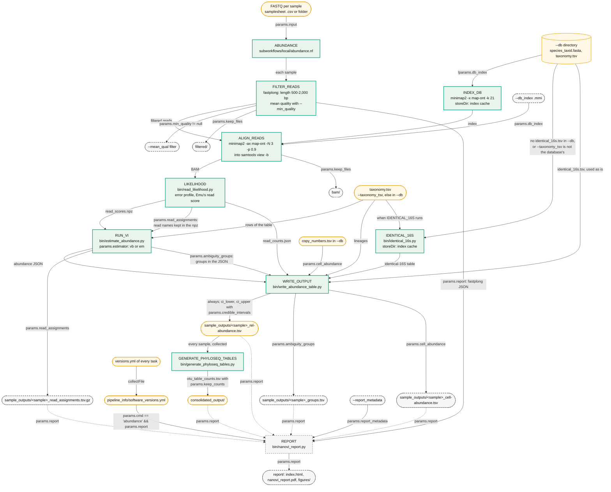
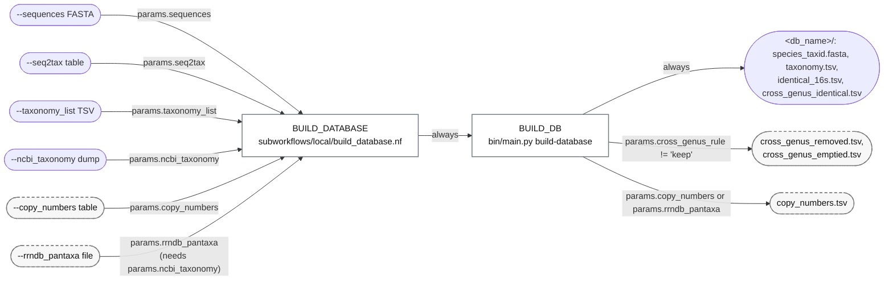
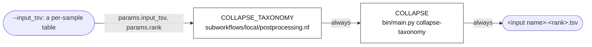
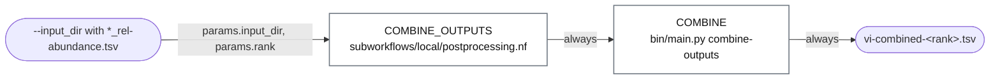

# NanoVI workflow

How the processes of each `--cmd` connect and which parameter switches each step or output
on. The one-figure overview is [`images/nanovi_overview.svg`](images/nanovi_overview.svg);
the parameters are in the [README](../README.md#parameters), the files in
[output.md](output.md) and the model in [methods.md](methods.md).

**How to read the diagrams.** Every box with an upper-case name is a process or subworkflow
named as in `main.nf` and `subworkflows/local/`; rounded boxes are files. An edge label is
either the condition under which the edge exists, written as `main.nf`, the subworkflow or
the module tests it (`params.ambiguity_groups`), or, for an edge that always exists, what it
carries. Boxes with a solid green border run with the default parameters, two of them
only when the run needs them: INDEX_DB is skipped with `--db_index` or when the index
cache already holds the index, and IDENTICAL_16S runs only when the run has no
identical-16S table to use (so not for a database from `bin/build_gtdb_db.py` or
`--cmd build-database`, which ships one, unless `--taxonomy_tsv` is another file). Boxes
with a dashed border need a parameter.

`tests/check_workflow_diagram.sh` (run in CI) fails when a process or subworkflow that
`main.nf` or a subworkflow includes is not named in a diagram or table on this page, or when
the page shows one that the code no longer includes.

---

## `--cmd abundance` (the default)

`main.nf` checks the inputs, reads the samples (a `.csv` samplesheet checked against
`assets/schema_input.json`, or a folder of FASTQ files) and calls `ABUNDANCE`; `REPORT`
runs after `pipeline_info/software_versions.yml` is written, because it reads it.

`INDEX_DB` and `IDENTICAL_16S` keep their outputs with `storeDir` in `--index_cache_dir`
(default `<output_dir>/index_cache`) under names that record the database, so a later run
that finds the file skips the task. `IDENTICAL_16S` runs only when the run has no table to
use: `--db` has no `identical_16s.tsv`, or `--taxonomy_tsv` is not `<db>/taxonomy.tsv`;
without a FASTA (`--db_index` alone) the `identical_16s_species` column is left empty.
`--cell_abundance` stops the run at launch when `--db` has no `copy_numbers.tsv` or when
`--taxonomy_tsv` is not the database's own.

---

## `--cmd build-database`

`main.nf` needs `--sequences`, `--seq2tax` and exactly one of `--taxonomy_list` or
`--ncbi_taxonomy`, and at most one of `--copy_numbers` or `--rrndb_pantaxa`.
`bin/build_gtdb_db.py` builds a GTDB database outside Nextflow with the same files
([output.md](output.md#binbuild_gtdb_dbpy)).

---

## `--cmd collapse-taxonomy`

---

## `--cmd combine-outputs`

`main.nf` stops `combine-outputs` before it runs when `--input_dir` holds no
`*_rel-abundance.tsv`.

---

## Parameter gates

Each step or output and the condition under which it runs, as the code tests it.

| Step | Runs when | Where the condition is |
|---|---|---|
| `ABUNDANCE`, `FILTER_READS`, `ALIGN_READS`, `LIKELIHOOD`, `RUN_VI`, `WRITE_OUTPUT`, `GENERATE_PHYLOSEQ_TABLES` | `params.cmd == 'abundance'` (the default) | `main.nf` |
| `FILTER_READS`: mean-quality filter | `params.min_quality != null` | `modules/local/filter_reads.nf` |
| `INDEX_DB` | `!params.db_index` (no prebuilt index) | `subworkflows/local/abundance.nf` |
| `IDENTICAL_16S` | no `identical_16s.tsv` in `--db`, or `--taxonomy_tsv` other than `<db>/taxonomy.tsv`, and a FASTA to build it from | `main.nf`, `subworkflows/local/abundance.nf` |
| `LIKELIHOOD`: read names in the npz | `params.read_assignments` | `modules/local/likelihood.nf` |
| `RUN_VI`: `<sample>_read_assignments.tsv.gz` | `params.read_assignments` | `modules/local/inference.nf` |
| `RUN_VI`: groups in the JSON; `WRITE_OUTPUT`: `<sample>_groups.tsv` | `params.ambiguity_groups` | `modules/local/inference.nf`, `write_output.nf` |
| `WRITE_OUTPUT`: `<sample>_cell-abundance.tsv` | `params.cell_abundance` (and `copy_numbers.tsv` in `--db`) | `main.nf`, `modules/local/write_output.nf` |
| `WRITE_OUTPUT`: `ci_lower`, `ci_upper` | `params.credible_intervals` (needs `--estimator vb`) | `main.nf`, `modules/local/write_output.nf` |
| `WRITE_OUTPUT`: `estimated_counts`; `GENERATE_PHYLOSEQ_TABLES`: `otu_table_counts.tsv` | `params.keep_counts` (default `true`) | `modules/local/write_output.nf` |
| `ALIGN_READS`, `FILTER_READS`: publish `bam/`, `filtered/` | `params.keep_files` | `conf/modules.config` |
| `REPORT` | `params.cmd == 'abundance' && params.report` | `main.nf` |
| `BUILD_DATABASE`, `BUILD_DB` | `params.cmd == 'build-database'` | `main.nf` |
| `BUILD_DB`: `copy_numbers.tsv` | `params.copy_numbers` or `params.rrndb_pantaxa` | `main.nf` |
| `BUILD_DB`: `cross_genus_removed.tsv`, `cross_genus_emptied.tsv` | `params.cross_genus_rule != 'keep'` | `modules/local/build_database.nf` |
| `COLLAPSE_TAXONOMY`, `COLLAPSE` | `params.cmd == 'collapse-taxonomy'` | `main.nf` |
| `COMBINE_OUTPUTS`, `COMBINE` | `params.cmd == 'combine-outputs'` | `main.nf` |

---

## Processes and subworkflows

### Subworkflows

| Subworkflow | Command | Calls |
|---|---|---|
| `ABUNDANCE` | `abundance` | `FILTER_READS`, `INDEX_DB`, `IDENTICAL_16S`, `ALIGN_READS`, `LIKELIHOOD`, `RUN_VI`, `WRITE_OUTPUT`, `GENERATE_PHYLOSEQ_TABLES` |
| `BUILD_DATABASE` | `build-database` | `BUILD_DB` |
| `COLLAPSE_TAXONOMY` | `collapse-taxonomy` | `COLLAPSE` |
| `COMBINE_OUTPUTS` | `combine-outputs` | `COMBINE` |

### Processes

Containers and resources are set per label in `conf/base.config`; with `-profile conda` the
same tools come from bioconda, the Python steps from `containers/environment.yml` and the
report from `containers/report/environment.yml`. `<version>` is NanoVI's version. Every
process also writes a `versions.yml`, collected into `pipeline_info/software_versions.yml`
and not published beside the results.

| Process | Label | Image | Publishes |
|---|---|---|---|
| `FILTER_READS` | `filter_reads` | `quay.io/biocontainers/fastplong:0.7.0--h43da1c4_0` | `qc/fastplong/<sample>_report.{html,json}.gz`; `filtered/<sample>_filtered.fastq.gz` with `--keep_files` |
| `INDEX_DB` | `alignment` | BioContainers mulled minimap2 2.31 + samtools 1.24 (`mulled-v2-66534bcb…`) | the index into `--index_cache_dir` (storeDir) |
| `IDENTICAL_16S` | `vi_database` | `ghcr.io/microbialds/nanovi-python:<version>` | the identical-16S table into `--index_cache_dir` (storeDir) |
| `ALIGN_READS` | `alignment` | as `INDEX_DB` | `bam/<sample>_vi_alignments.bam` with `--keep_files` |
| `LIKELIHOOD` | `vi_stats` | `ghcr.io/microbialds/nanovi-python:<version>` | nothing (the npz and counts JSON stay in the work directory) |
| `RUN_VI` | `vi_inference` | `ghcr.io/microbialds/nanovi-python:<version>` | `sample_outputs/<sample>_read_assignments.tsv.gz` with `--read_assignments` |
| `WRITE_OUTPUT` | `vi_output` | `ghcr.io/microbialds/nanovi-python:<version>` | `sample_outputs/<sample>_rel-abundance.tsv`; `<sample>_groups.tsv` with `--ambiguity_groups`; `<sample>_cell-abundance.tsv` with `--cell_abundance` |
| `GENERATE_PHYLOSEQ_TABLES` | `vi_output` | `ghcr.io/microbialds/nanovi-python:<version>` | `consolidated_output/`: `otu_table_abundance.tsv`, `otu_table_counts.tsv` (with counts), `tax_table.tsv`, `sample_metadata.tsv` |
| `REPORT` | `report` | `ghcr.io/microbialds/nanovi-report:<version>` | `report/` with `--report` |
| `BUILD_DB` | `vi_database` | `ghcr.io/microbialds/nanovi-python:<version>` | `<output_dir>/<db_name>/` |
| `COLLAPSE` | `vi_collapse` | `ghcr.io/microbialds/nanovi-python:<version>` | `<output_dir>/<input name>-<rank>.tsv` |
| `COMBINE` | `vi_combine` | `ghcr.io/microbialds/nanovi-python:<version>` | `<output_dir>/vi-combined-<rank>.tsv` |

Nextflow's own `pipeline_info/timeline.html`, `report.html` and `trace.txt` are written for
every command.
